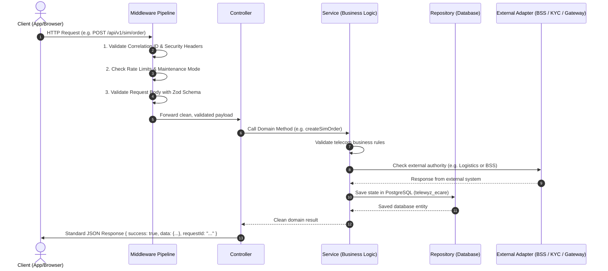
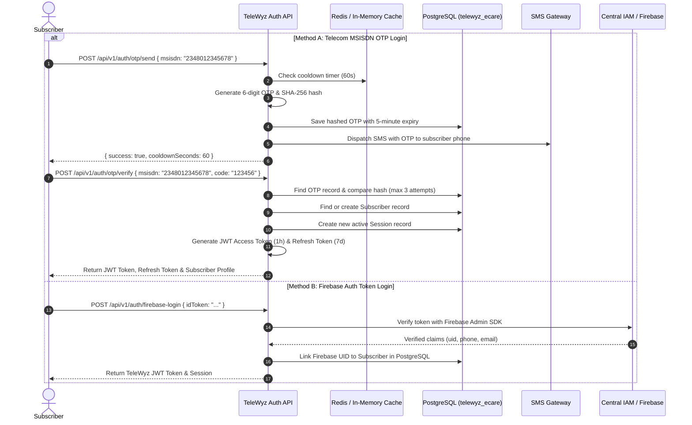
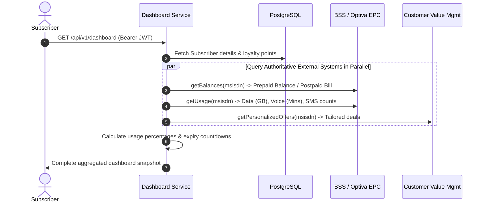
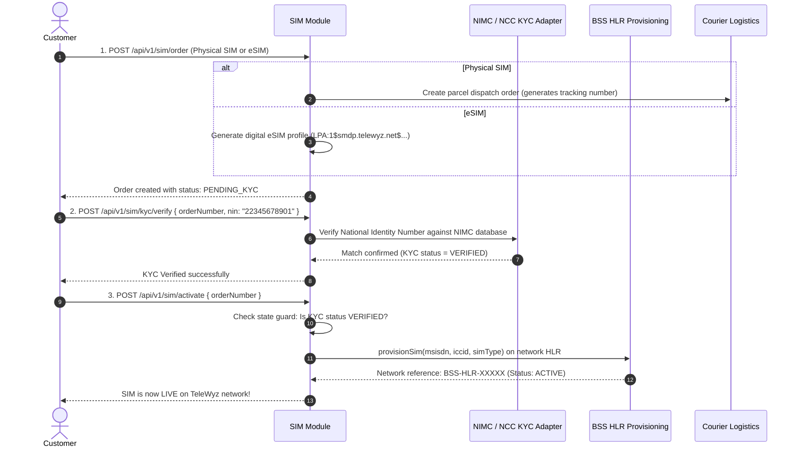
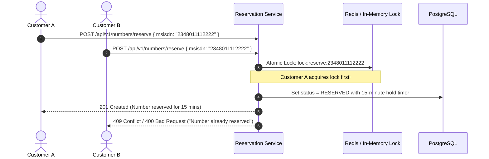
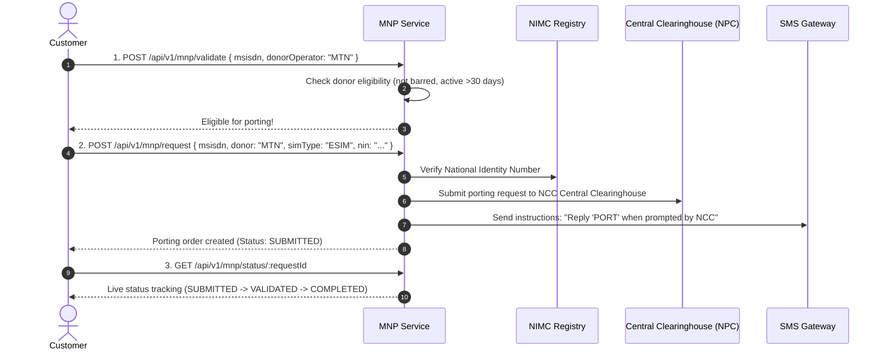
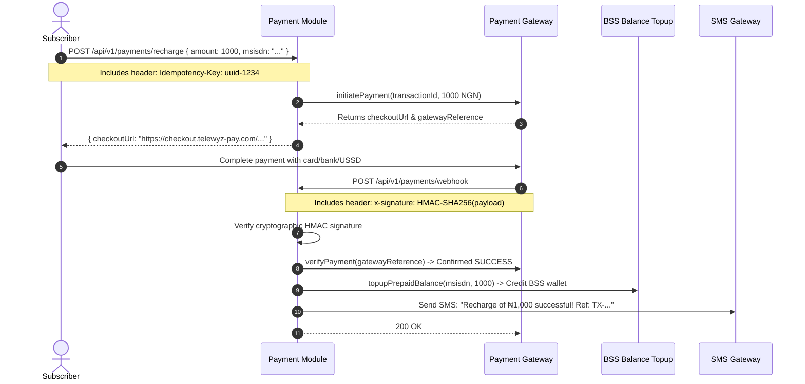
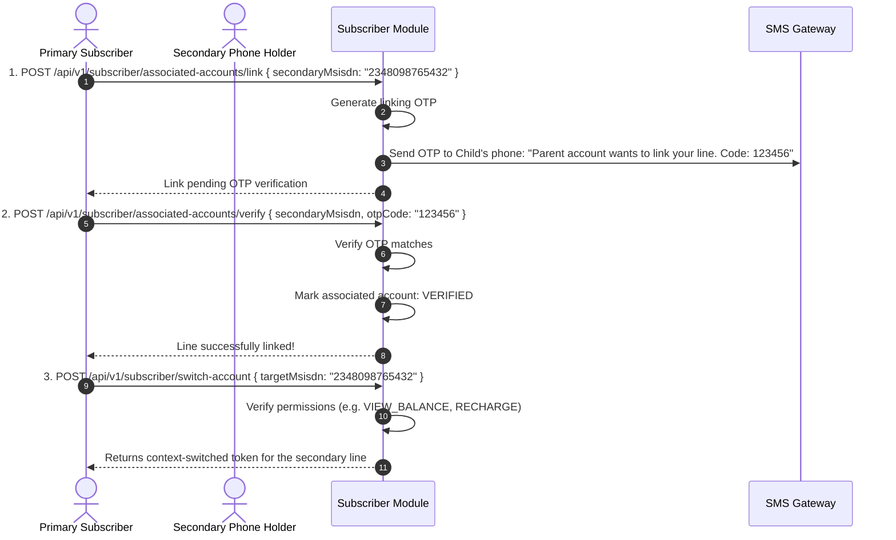
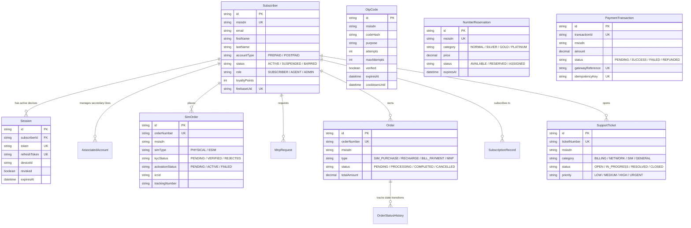

# TeleWyz E-Care — Complete Project Flow & Architecture Guide

Welcome to the **TeleWyz E-Care Backend Guide**! This document explains how the entire telecom self-care platform works from end to end in simple, practical terms.

---

## 1. What is TeleWyz E-Care?

TeleWyz E-Care is a **Telecom Self-Care Platform** (similar to apps like *Airtel Thanks*, *MyJio*, *MTN Self-Care*, or *MyVodafone*). 

Subscribers use it to:
- Log in with their mobile number (MSISDN) or Firebase Auth.
- Check their real-time data, voice, and SMS balances.
- Buy airtime, data bundles, and postpaid bill payments.
- Pick and reserve a new phone number (normal or VIP/platinum).
- Order a Physical SIM (delivered to their doorstep) or an eSIM (with instant QR code).
- Complete biometric identity verification (NIMC/NCC NIN KYC).
- Switch mobile networks (Mobile Number Portability — MNP).
- Link family numbers under one master account with permission controls.

---

## 2. High-Level System Architecture

```mermaid
flowchart TD
    Client["Mobile App / Web Frontend / Postman"]
    
    subgraph Middleware_Pipeline ["15-Layer Security & Middleware Pipeline"]
        M1["1. Correlation ID (x-correlation-id)"]
        M2["2. Helmet Security Headers"]
        M3["3. CORS Origin Guard"]
        M4["4. Body Size Limiter (1MB)"]
        M5["5. Pino Request Logger (Redacts PII)"]
        M6["6. Maintenance Gate"]
        M7["7. Token Bucket Rate Limiter"]
        M8["8. Firebase & JWT Auth Middleware"]
        M9["9. Role-Based Access Control (RBAC)"]
        M10["10. Zod Schema Validation"]
        M11["11. Idempotency Protection (Idempotency-Key)"]
        M12["12. Webhook HMAC-SHA256 Signature Validator"]
        M13["13. Security Audit Logger"]
        M14["14. 404 Route Handler"]
        M15["15. Centralized Error Handler"]
    end

    subgraph Business_Domains ["Domain Modules (Controllers + Services)"]
        Auth["Auth & Sessions Module"]
        Sub["Subscriber & Accounts Module"]
        Dash["Aggregated Dashboard Module"]
        Cat["Product Catalogue Module"]
        Res["Number Reservation Module"]
        Sim["SIM & KYC Module"]
        Mnp["MNP Porting Module"]
        Pay["Payments & Recharge Module"]
        Ord["Unified Orders Module"]
        Notif["Async Notifications Module"]
        Serv["Loyalty, Stores & Tickets Module"]
    end

    subgraph Persistence ["Database & Cache"]
        PG[("PostgreSQL Database\n(telewyz_ecare via Prisma)")]
        Redis[("Redis / Memory Cache\n(Rate limits, locks, sessions)")]
    end

    subgraph External_Integrations ["Authoritative Telecom Integrations (Adapters)"]
        BSS["Optiva EPC / BSS\n(Balances, Usage & HLR Provisioning)"]
        IAM["Central IAM / Firebase Auth"]
        GW["Payment Gateway"]
        NIMC["NIMC / NCC Biometric KYC"]
        SMS["SMS Gateway"]
        SMTP["SMTP Mailer"]
        FCM["Firebase Push Notifications"]
        LOG["Logistics Courier Dispatch"]
        DMP["Dealer Management Platform"]
        CVM["Customer Value Management"]
        COMM["Community Support Portal"]
        DWH["Data Warehouse Stream"]
    end

    Client --> Middleware_Pipeline
    Middleware_Pipeline --> Business_Domains
    Business_Domains --> Persistence
    Business_Domains --> External_Integrations
```



---

## 3. How a Request Travels Through the Backend

Every single request follows the clean **Controller → Service → Repository/Adapter** pattern:



---

## 4. Step-by-Step Business Workflows

### Workflow 1: Login & Authentication (MSISDN OTP vs Firebase)



---

### Workflow 2: Aggregated Dashboard (BSS Authority)

> [!IMPORTANT]
> **Why Telecom Balances Are NOT Stored in Local DB:**
> In telecom architecture, subscribers make calls, send SMS, and stream video every second. The **Optiva EPC / BSS** (Business Support System) is the real-time metering engine that tracks every byte. TeleWyz queries BSS directly so the user always sees their exact, up-to-the-second balance.



---

### Workflow 3: SIM Purchase & KYC Activation (Physical SIM & eSIM)



---

### Workflow 4: Concurrency-Safe Number Reservation

Prevents two people from reserving or buying the exact same phone number at the same millisecond:



---

### Workflow 5: Mobile Number Portability (MNP)

Switching from another network (MTN, Airtel, Glo, 9mobile) to TeleWyz without changing your number:



---

### Workflow 6: Recharge, Payments & Webhooks (Idempotent)

> [!CAUTION]
> **Golden Telecom Payment Rule:**
> Never trust payment success from the mobile app or browser! The backend always verifies the transaction directly with the payment provider via server-to-server verification or cryptographically signed HMAC webhooks.



---

### Workflow 7: Associated Accounts (Family & Secondary Lines)

Allows a parent or business account to manage secondary numbers with strict permission control:



---

## 5. Database Schema & Relationships

All tables are created in the **`telewyz_ecare`** PostgreSQL database via Prisma:



---

## 6. Key Telecom Terms Simplified

| Term | What It Means | Why It Matters |
| :--- | :--- | :--- |
| **MSISDN** | Your standard mobile phone number (e.g. `2348012345678`). | Used as the subscriber's primary identity. |
| **IMSI** | International Mobile Subscriber Identity (inside the SIM chip). | Network identifier used by cellular towers. |
| **ICCID** | The 19-to-20 digit serial number printed on the physical SIM card or embedded in the eSIM chip. | Used to provision the line on the network HLR. |
| **BSS** | Business Support System (Optiva EPC). | The authoritative telecom engine for balances, data allowances, charging, and provisioning. |
| **HLR / HSS** | Home Location Register / Home Subscriber Server. | The cellular network core database that activates your SIM so it gets cellular signal. |
| **MNP** | Mobile Number Portability. | Regulatory feature that lets you switch carriers (e.g. MTN to TeleWyz) while keeping your phone number. |
| **NIN / KYC** | National Identity Number / Know Your Customer. | Mandatory Nigerian telecom regulation (NIMC / NCC) requiring biometric ID verification before any SIM can be activated. |
| **Idempotency** | Preventing duplicate charges if a user clicks "Pay" twice or their network reconnects. | If the same `Idempotency-Key` is sent, the server returns the previous result without charging again. |

---

## 7. How to Test Any Feature in 30 Seconds

1. Start the server:
   ```powershell
   npm start
   ```
2. Open your browser to the **interactive Swagger documentation**:
   👉 **`http://localhost:3000/api-docs`**
3. Pick any endpoint:
   - Click **Try it out**
   - Click **Execute**
   - View the live response instantly!

